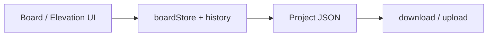

# アーキテクチャ

## 画面

1. **平面ボード** — 間取り背景 + 矩形（選択・移動・リサイズ・寸法入力）+ 縮尺校正
2. **立面ボード** — 平面オブジェクトのダブルクリックで開く。平面と同様に矩形を配置・寸法入力できる
3. **ツールバー** — 背景画像の読込、ズーム、Undo/Redo、ファイルのダウンロード / 読込（Bootstrap ベース）

## データフロー

- UI イベント → store 更新（履歴付き）→ キャンバスが store を購読して再描画
- 永続化はファイルのみ。ブラウザには保存しない
- 立面は平面オブジェクトに紐づく（1:1）。立面内にも矩形オブジェクト配列を持つ

## 縮尺

- 平面・立面それぞれ（またはプロジェクト共通）に、基準線校正で `mmPerPixel` を持つ
- オブジェクトの `width` / `height` は論理ピクセルと mm の両方を扱えるようにし、表示・入力は mm を優先
- 校正 UI: 2 点指定 + 実寸入力。補助プリセットは AGENTS.md の調査メモに従う

## 実行環境

- 開発・日常の確認: Docker Compose サービス `web`（Vite HMR、`5173`）
- 本番ビルド相当の確認: Compose の `preview` プロファイル（`vite preview`）。自前 nginx は置かない（公開は GitHub Pages）
- 公開: GitHub Pages（CI で `npm run build` → `dist/`）
- フォーマット: コミット前に `docker compose run --rm web npm run format`（起動中は `exec -T`）。ホスト直の Prettier は使わない。詳細は `@AGENTS.md`

## UI / 状態

- ツールバー・モーダル・フォーム: `react-bootstrap` + Bootstrap 5 CSS。Bootstrap の JS プラグインは使わない
- ドキュメント状態: Zustand。Undo/Redo は zundo の `temporal`。履歴対象はオブジェクト・縮尺・背景などドキュメント本体に限定（`partialize`）
- 導入済み: Vite + React + TS、Compose（`web` / `preview`）、型、store（Undo/Redo）、平面キャンバス（背景画像・矩形の追加/選択/移動/リサイズ）
- 未実装: 立面、寸法・縮尺校正、間取りデータの download / upload、Pages 用 Actions

## 非機能

- オフライン利用可能な静的アプリ
- 背景画像は読込時 Object URL。ファイルへ書き出すときは埋め込み方針を domain-model に従う

詳細型: `@docs/domain-model.md`  
採用理由の要約: `@AGENTS.md` の「採用決定」
